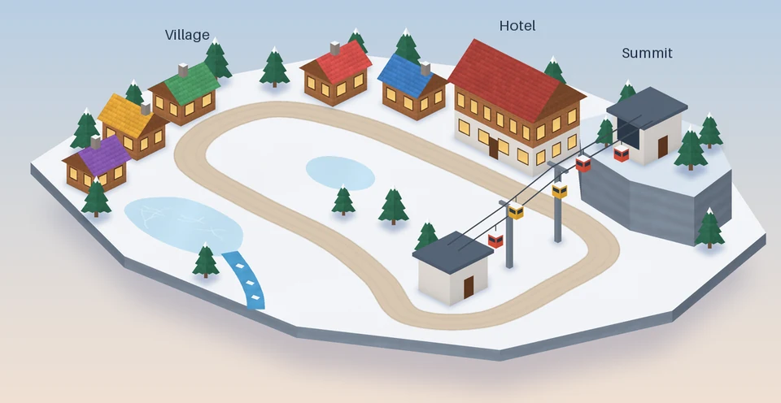
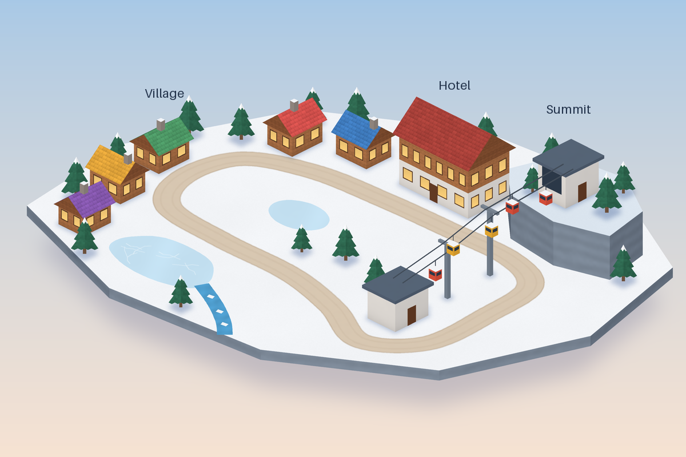
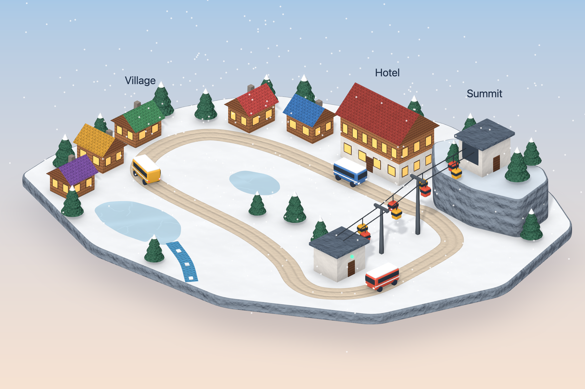
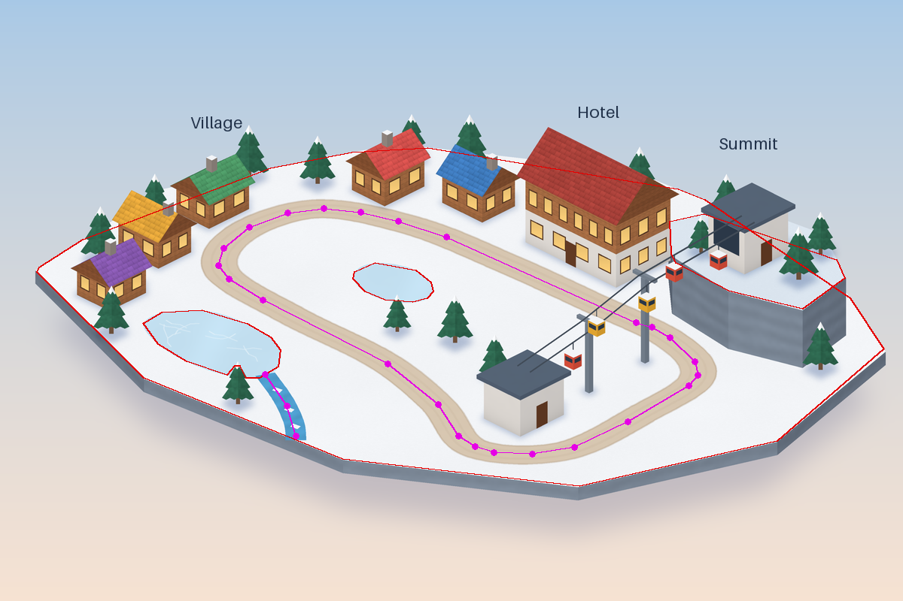

# illustration-to-3d-scene

**A flat isometric illustration → a live, textured, animated 3D scene in React Three Fiber.** The scene is
built from code primitives, measured from the image instead of eyeballed, and checked against the image in
a one-minute render loop. No ML, no Blender, no artwork cut out of the drawing.



*The animation opens on the flat illustration (`examples/alpine/reference.png`), cross-fades into the 3D
rebuild rendered on the GPU at the same camera, plays seven seconds of the animation and loops back.
It is produced by `node verify/shoot.mjs gif`.*

## Example: before and after

**Before:** the flat illustration the scene is rebuilt from ([`examples/alpine/reference.png`](examples/alpine/reference.png)).



**After:** the live 3D scene, rendered on the GPU from the same camera, with procedural wood, shingle,
snow, ice and rock textures.



## How it works

1. **Calibrate.** Pick a few corners you can name in 3D; `tools/calibrate.py` fits the isometric camera
   (anchor, scale, elevation). From then on every pixel is a world coordinate: `iso(px, py, height)`.
2. **Measure.** `tools/layout.py` turns colour regions into ground polygons and bands into centrelines,
   measured in a top view, including closed loops and raised plates:

   

3. **Build from primitives.** The kit in `viewer/src/kit/` has ground plates with paths, buildings with
   openings and gable roofs, pine forests, masts, tracks that carry items along a curve (a gondola cable,
   a stream, a moving walkway), vehicles, snowfall, and canvas-generated textures (wood, shingles, snow,
   ice, rock, bark, foliage, ripples).
4. **Verify.** `verify/shoot.mjs` renders on the real GPU and compares with the illustration: edge overlay
   with a pixel ruler, side by side, an edge score, time sequences, frame rate at 4K.
5. **Animate by computation.** Routes run at constant speed with stops and dwell times; departure offsets
   come from the path lengths so vehicles never overlap; coupled motion (the gondola runs faster while a
   bus waits at its station) is integrated from the schedule. Every frame is a pure function of time.
6. **Harden for kiosks.** Offline precache, fullscreen button, adaptive pixel ratio, `?quality=low`, and
   reloads on WebGL context loss and after a set uptime.

The example scores 0.27 px calibration residual, finds the road as one closed loop within 0.12 world units
of the ground truth, and runs at 60 fps with vsync at 3840×2160 (115 fps uncapped) on an M1 Max.

## Quick start

Requirements: Python 3.10+, Node 20.19+ or 22.12+, a GPU.

```bash
python3 -m venv .venv && .venv/bin/pip install -r tools/requirements.txt
(cd viewer && npm install)
(cd verify && npm install && npx playwright install chromium)

examples/alpine/measure.sh                      # illustration, calibration, layout
(cd viewer && npm run dev)                      # http://localhost:5188
node verify/shoot.mjs compare --reference examples/alpine/reference.png --out shots/compare
node verify/shoot.mjs gif --reference examples/alpine/reference.png --out docs/images/demo.webp --crop 0 110 1200 730
```

Viewer switches: `?quality=low`, `?fit=cover`, `?t=3` (freeze time), `?ref=0.5` (overlay the illustration),
`?snow=0`, `?uptime=12`, `?ui=0`, `?adaptive=0`. `npm run build` type-checks and emits a precaching build;
`npm run licenses` checks the dependency licences.

## Repository layout

```
tools/            iso.py, calibrate.py, layout.py, overlay.py (compare, contact sheets), animate.py (GIF)
examples/alpine/  make_image.py (the synthetic textured illustration + truth.json), points.json,
                  calibration.json, layout.json, measure.sh
viewer/src/kit/   generic components, scheduler, texture generators, kiosk helpers
viewer/src/example/  the alpine scene built from the measured data
verify/shoot.mjs  still | sequence | fps | compare | gif | kiosk
SKILL.md          agent skill: the workflow step by step (linked into .claude/skills/)
JOURNEY.md        what did not work and why
LICENSES.md       third-party licences
```

## Limits

- Orthographic art only (fixed 45° azimuth, fitted elevation).
- Shapes are what the kit has: boxes, gables, extruded plates, cones, ribbons, tubes and simple vehicles.
- Measurement relies on colour regions; anything standing in front of a measured band or edge hides it.
  Place it with the calibration and a ruler instead (see `SKILL.md`).

## Licence

MIT, see [`LICENSE`](LICENSE); third-party licences in [`LICENSES.md`](LICENSES.md). Only rebuild artwork
you have the rights to use.
